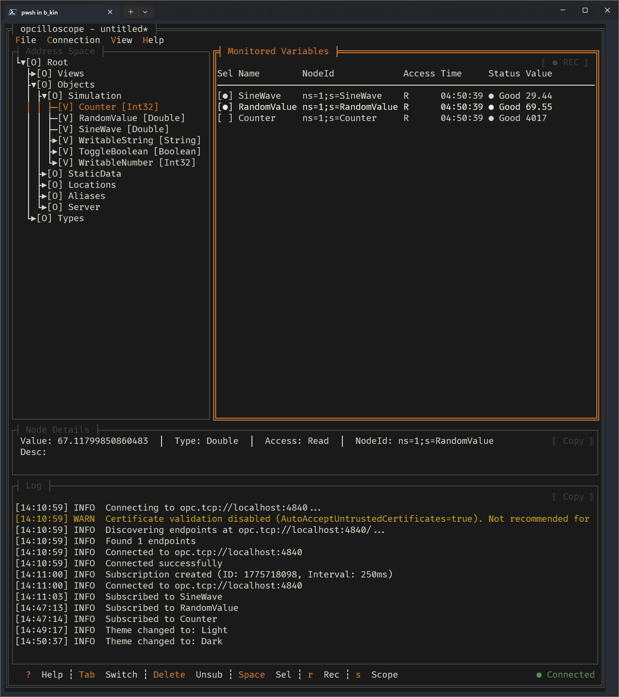
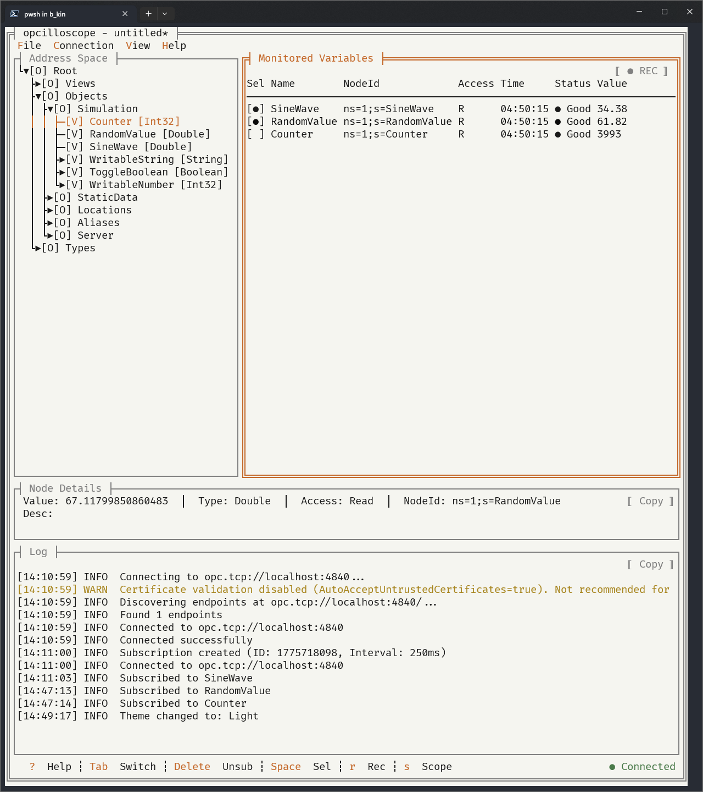
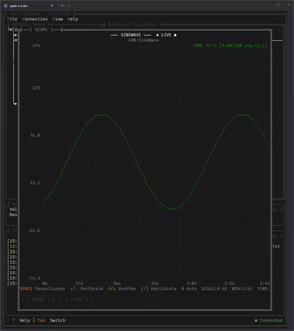

# aiot

**A lightweight, cross-platform OPC UA client for the terminal.**

Browse, monitor, and subscribe to industrial automation data right from your terminal. Keyboard-driven with mouse support. No bloated GUI, no complex setup, no license fees.

[](https://dotnet.microsoft.com/download/dotnet/10.0)
[](LICENSE)
[](https://github.com/gui-cs/Terminal.Gui)

<p align="center">
  
</p>

## Why aiot?

| Traditional OPC Clients | aiot |
|------------------------|--------------|
| Heavy desktop apps | Single portable binary |
| Minutes to install | `curl \| bash` and you're running |
| Resource-hungry GUIs | ~40 MB RAM |
| Windows-only | Windows, Linux, macOS (x64 & ARM) |
| Click-heavy workflows | Keyboard-driven, mouse support |

**Use cases:** commissioning (verify PLC tags), troubleshooting (live values during fault diagnosis), integration testing (validate OPC UA server configs), recording (export to CSV for reports).

## Features

- **Multi-Protocol** — Unified access for OPC UA, MQTT, WebSocket, and common industrial protocols via Byoe adapters (Modbus TCP/RTU, Siemens S7, Mitsubishi MC, Omron FINS, Delta, Xinje).
- **Dual Mode** — Interactive TUI for engineers and machine-readable CLI/NDJSON mode for AI agents and automation scripts.

- **Browse** — Lazily explore the OPC UA address space. Expand only what you need.
- **Monitor** — Subscribe to variables with `Enter`. Real-time updates via OPC UA pub/sub, not polling.
- **Inspect** — Full node attributes: Description, DataType, AccessLevel, ValueRank.
- **Scope** — Real-time multi-signal oscilloscope (up to 5 signals, 30 s sliding window).
- **Trend Plot** — Single-signal trend view with auto-scaling.
- **Record** — Export monitored values to CSV. Zero data loss — every server-pushed sample is captured.
- **Configure** — Save/load connection and subscription configs (`.cfg` JSON files).
- **Themes** — Dark (default) and light.

## Protocol capability matrix

| Protocol | Read | Write | Monitor | Browse |
|---|---|---|---|---|
| OPC UA | Native node read | Native node write | Native subscription | Native address space |
| MQTT | Cached last message by topic | Publish to topic | Subscribe topic stream | Cached observed topics |
| WebSocket | Cached last message by address | Send text payload (`address=value`) | Stream cached received messages | Cached observed addresses |
| Modbus TCP / RTU | Native register/coil read (typed) | Native register/coil write | Polling-based monitor | Not supported |
| Siemens S7 | Native read (typed) | Native write | Polling-based monitor | Not supported |
| Mitsubishi MC | Native read (typed) | Native write | Polling-based monitor | Not supported |
| Omron FINS | Native read (typed) | Native write | Polling-based monitor | Not supported |
| Delta | Native read (typed) | Native write | Polling-based monitor | Not supported |
| Xinje | Native read (typed) | Native write | Polling-based monitor | Not supported |

<p align="center">
  
  
</p>

<p align="center">
  <br>
  <em>Scope view — a soothing sine wave</em>
</p>

<details>
<summary><strong>How signal sampling works</strong></summary>

aiot does **not** poll your OPC UA server. The server *pushes* value updates using OPC UA's built-in publish/subscribe mechanism.

```
OPC UA Server
  │  pushes values every 250ms (configurable 100ms–10s)
  ▼
aiot receives value change events
  ├─→ Scope View     — stores every sample (up to 2,000 per signal)
  ├─→ Trend Plot     — stores last 200 samples in a ring buffer
  └─→ CSV Recording  — writes every sample to disk (zero data loss)
```

Data capture and screen rendering are decoupled:

| What | Rate | Details |
|------|------|---------|
| Server → Client updates | ~4 Hz (250 ms) | Default publishing + sampling interval, adjustable in connect dialog |
| Scope / Trend Plot redraw | 10 FPS (100 ms) | Renders whatever samples arrived since last frame |
| CSV recording | Every update | Captures 100% of server-pushed values, flushes every 10 records |

The scope view holds a sliding **30-second window** (zoomable 5 s – 300 s). Display resolution is limited by terminal width — each character cell is one data point.

</details>

## Keyboard Shortcuts

| Key | Action |
|-----|--------|
| `Tab` | Cycle between panes |
| `Enter` | Subscribe to selected node |
| `Delete` | Unsubscribe from selected variable |
| `A` | Add monitor address (non-OPC protocols) |
| `E` | Edit selected monitor address/type/length (non-OPC protocols) |
| `Space` | Toggle selection / pause scope |
| `S` | Open scope with selected variables |
| `T` | Show trend plot |
| `W` | Write value to node |
| `+` / `-` | Zoom in / out (scope) |
| `Ctrl+O` / `Ctrl+S` | Open / save configuration |
| `Ctrl+R` | Toggle CSV recording |
| `?` | Help |

## Multi-Protocol TUI Quick Notes

In **Connect** dialog, choose protocol first, then enter endpoint:

- OPC UA: `opc.tcp://localhost:4840`
- MQTT: `mqtt://127.0.0.1:1883`
- WebSocket: `ws://127.0.0.1:8080/ws`
- Modbus TCP: `modbus.tcp://127.0.0.1:502`
- Modbus RTU: `modbus.rtu://COM3?baud=9600&station=1`
- Siemens S7: `s7://192.168.0.10:102?plc=s1200&rack=0&slot=1`
- Mitsubishi MC: `melsec://192.168.0.11:6000`
- Omron FINS: `omron://192.168.0.12:9600`
- Delta: `delta://192.168.0.13:502?series=dvp&station=1`
- Xinje: `xinje://192.168.0.14:502?series=xc&station=1`

For non-OPC protocols:

- Use `A` to add monitor addresses (for example `100`, `DB1.0`, `D100`, `CIO0.00`).
- Use `E` to edit the selected monitor point address, data type, and length.
- Use `W` on selected monitored variable to write a value.
- Use `Delete` to remove monitored address from the list.
- `string` / `hex` monitor points require a positive `Length` value.
- Saved `.cfg` files now persist protocol, endpoint, extra connection parameters, monitor point data type, and length for non-OPC sessions.
- For Modbus RTU in TUI, you can set **baud** and **station** directly in the Connect dialog (no query string required).
- For MQTT in CLI, optional flags: `--client-id`, `--user`, `--pass`, `--qos`, `--retain`.
- For WebSocket in TUI, optional extras include `subprotocol`, `address`, `header` (`k1:v1;k2:v2`).

Supported protocol keys in CLI/TUI today:

- `opcua`
- `mqtt`
- `websocket`
- `modbus.tcp`
- `modbus.rtu`
- `siemens.s7`
- `melsec`
- `omron`
- `delta`
- `xinje`

CLI examples for protocol extras:

```powershell
dotnet run --project AIoT/AIoT.csproj -- write mqtt://127.0.0.1:1883 "" 23.5 --protocol mqtt --topic sensors/temp --qos 1 --retain --format json
dotnet run --project AIoT/AIoT.csproj -- monitor ws://127.0.0.1:8080/ws --protocol websocket --ws-subprotocol telemetry --ws-header "X-Site:line1;X-Role:agent" --ws-address '$last' --count 3 --format ndjson
```

## Install


<details>
<summary>Linux dependency: ICU libraries</summary>

aiot requires ICU libraries at runtime for globalization support.

```bash
# Debian 13 / Ubuntu 24.04+
sudo apt install libicu72       # or: sudo apt install libicu-dev

# Fedora / RHEL
sudo dnf install libicu
```

</details>

<details>
<summary>Uninstall</summary>


</details>

## Quickstart (Developer)

Requires [.NET 10 SDK](https://dotnet.microsoft.com/download/dotnet/10.0).


Run tests:
```bash
dotnet test
```

CLI smoke commands (OPC UA + Modbus):
```powershell
./scripts/smoke-cli.ps1
```

Publish executable packages (cross-platform):

```powershell
./scripts/publish.ps1
```

```bash
./scripts/publish.sh
```

See `docs/cli-smoke-tests.md` for individual command examples.

中文完整上手文档请见：`docs/中文使用说明.md`。

新手快速文档：`docs/中文使用说明-新手入门.md`。

产品介绍网页：`docs/aiot-product-intro.zh-CN.html`。

按角色拆分的中文文档：

- 现场工程师版：`docs/中文使用说明-现场工程师版.md`
- Skills 开发版：`docs/中文使用说明-Skills开发版.md`
- Byoe 插件扩展指南：`docs/使用Byoe扩展AIoT插件指南.md`

Use `docs/e2e-acceptance-checklist.md` for full TUI+CLI regression checks.

A minimal GitHub Actions workflow is available at `.github/workflows/smoke-cli.yml`.

### Protocol plugins (optional)

AIoT supports optional protocol plugins loaded at startup from:

- `<app-base>/plugins/*.dll`

Plugin assemblies can provide additional implementations of `IProtocolFactory` / `IProtocolClient`.
If no plugins are present, built-in protocols continue to work as normal.

See `docs/plugin-packaging.md` for packaging and sample plugin usage.

You can force plugin-only routing (disable built-in protocol factories) by setting:

```text
AIOT_PROTOCOL_PLUGINS_ONLY=1
```

Reference plugin projects in this repository:

- `AIoT.PluginSamples.Echo` (sample demo protocol)
- `AIoT.PluginProtocols.Transport` (MQTT + WebSocket plugin migration)
- `AIoT.PluginProtocols.Byoe` (Byoe industrial protocol plugin migration)

## OPC UA Test Servers

**Built-in test server** (Counter, SineWave, RandomValue, writable nodes):
```bash
dotnet run --project Tests/AIoT.TestServer
# Starts at opc.tcp://localhost:4840
```

**Public servers** (no setup required):

| Server | Endpoint URL |
|--------|--------------|
| OPC UA Server | `opc.tcp://opcuaserver.com:48010` |
| Eclipse Milo | `opc.tcp://milo.digitalpetri.com:62541/milo` |

**Docker** ([Microsoft OPC PLC](https://github.com/Azure-Samples/iot-edge-opc-plc)):
```bash
docker run -p 50000:50000 mcr.microsoft.com/iotedge/opc-plc:latest \
  --autoaccept --unsecuretransport
# Connect to opc.tcp://localhost:50000
```

## Contributing

Contributions welcome! Please submit an issue or a pull request.

## License

MIT — see [LICENSE](LICENSE).

<p align="center">
  <strong>Built by <a href="https://squarewavesystems.com">Square Wave Systems</a></strong><br>
  <em>Inspired by <a href="https://github.com/jesseduffield/lazygit">lazygit</a></em>
</p>
